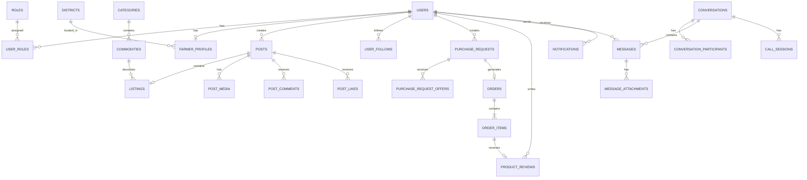

# TaniConnect — Database Design

## 1. Users & Roles
- users
- roles
- user_roles
- farmer_profiles
- districts
- user_follows

## 2. Marketplace

### CATEGORIES
- id
- name

### COMMODITIES
- id
- category_id (FK → categories)
- name
- unit

### LISTINGS
- id
- post_id (FK → posts, UNIQUE)
- commodity_id (FK → commodities)
- price
- stock
- unit
- status

### COMMODITY_PRICES
- id
- commodity_id (FK → commodities)
- district_id (FK → districts, nullable)
- price
- unit
- source
- recorded_at

### PRICE_RECOMMENDATIONS
- id
- listing_id (FK → listings)
- commodity_price_id (FK → commodity_prices)
- reference_price
- minimum_price
- maximum_price
- recommendation_status (TOO_LOW, FAIR, TOO_HIGH)
- created_at

## 3. Community
- posts
- post_media
- post_comments
- post_likes

## 4. Transactions

### PURCHASE_REQUESTS
- id
- buyer_id (FK → users)
- commodity_id (FK → commodities)
- quantity
- target_price
- status
- created_at

### PURCHASE_REQUEST_OFFERS
- id
- request_id (FK → purchase_requests)
- farmer_id (FK → users)
- offered_price
- message
- status

### ORDERS
- id
- request_id (FK → purchase_requests)
- accepted_offer_id (FK → purchase_request_offers, UNIQUE)
- buyer_id (FK → users)
- seller_id (FK → users)
- status
- created_at

### ORDER_ITEMS
- id
- order_id (FK → orders)
- listing_id (FK → listings)
- quantity
- price_snapshot

### PRODUCT_REVIEWS
- id
- order_item_id (FK → order_items, UNIQUE)
- reviewer_id (FK → users)
- rating (1–5)
- review
- created_at
- updated_at

## 5. Chat & Communication
- conversations
- conversation_participants
- messages
- message_attachments
- message_moderation_logs
- call_sessions

## 6. System
- notifications

## 7. Main Rules
- Username dan email harus unik.
- User dapat memiliki beberapa role.
- Post memiliki tipe THREAD atau LISTING.
- Listing wajib memiliki detail produk.
- Harga dan stok tidak boleh negatif.
- Rating produk bernilai 1–5.
- Review hanya dapat diberikan setelah transaksi selesai.
- Satu order item hanya boleh memiliki satu review.
- Pesan hanya dapat diedit atau dibatalkan oleh pengirim.
- User tidak boleh mengikuti dirinya sendiri.

## 8. Entity Relationship Diagram

## 9. Database Constraints

### Primary Key
- Setiap tabel memiliki primary key `id`.
- Tabel relasi menggunakan composite primary key jika diperlukan:
  - user_roles: user_id + role_id
  - user_follows: follower_id + following_id
  - post_likes: post_id + user_id
  - conversation_participants: conversation_id + user_id

### Unique Constraints
- users.username
- users.email
- farmer_profiles.user_id
- listings.post_id
- product_reviews.order_item_id

### Check Constraints
- listings.price >= 0
- listings.stock >= 0
- product_reviews.rating BETWEEN 1 AND 5
- posts.post_type IN ('THREAD', 'LISTING')

### Foreign Keys
- Semua relasi wajib menggunakan foreign key.
- Gunakan ON DELETE CASCADE untuk data turunan yang memang harus ikut dihapus.
- Gunakan ON DELETE RESTRICT untuk data transaksi yang perlu dipertahankan.

### Business Rules
- Post LISTING wajib memiliki detail listing.
- Review hanya boleh diberikan setelah order selesai.
- Hanya pembeli terkait yang boleh memberikan review.
- Satu order item hanya boleh memiliki satu review.
- Pesan hanya dapat diedit atau dibatalkan oleh pengirim.

## 10. Product Reviews
- product_reviews
- Rating 1–5.
- Review hanya dapat diberikan setelah transaksi selesai.
- Satu order item hanya memiliki satu review.
- Review dapat diedit oleh pembeli.

## 11. Reporting System

### REPORTS
- id (PK)
- reporter_id (FK → users)
- target_type (POST, COMMENT, ACCOUNT)
- post_id (FK → posts, nullable)
- comment_id (FK → post_comments, nullable)
- reported_user_id (FK → users, nullable)
- reason
- description
- status (PENDING, REVIEWED, RESOLVED, REJECTED)
- created_at
- updated_at

Fungsi:
- Melaporkan postingan.
- Melaporkan komentar.
- Melaporkan akun.
- Admin dapat meninjau dan mengambil tindakan.

Catatan: target_id mengarah ke tabel berbeda sesuai target_type. Validasi relasi dilakukan oleh aplikasi.

## 12. Commodity Price History

### COMMODITY_PRICES
- id
- commodity_id (FK → commodities)
- district_id (FK → districts, nullable)
- price
- unit
- source
- recorded_at

Fungsi:
- Menyimpan riwayat harga komoditas.
- Menampilkan grafik perubahan harga.
- Filter berdasarkan komoditas, wilayah, dan periode.

## 13. Listing Price Recommendation

### PRICE_RECOMMENDATIONS
- id
- listing_id (FK → listings)
- commodity_price_id (FK → commodity_prices)
- reference_price
- minimum_price
- maximum_price
- recommendation_status (TOO_LOW, FAIR, TOO_HIGH)
- created_at

Fungsi:
- Membandingkan harga listing dengan harga referensi komoditas.
- Memberi peringatan jika harga terlalu rendah.
- Memberi peringatan jika harga terlalu tinggi.
- Menampilkan rentang harga yang direkomendasikan.
