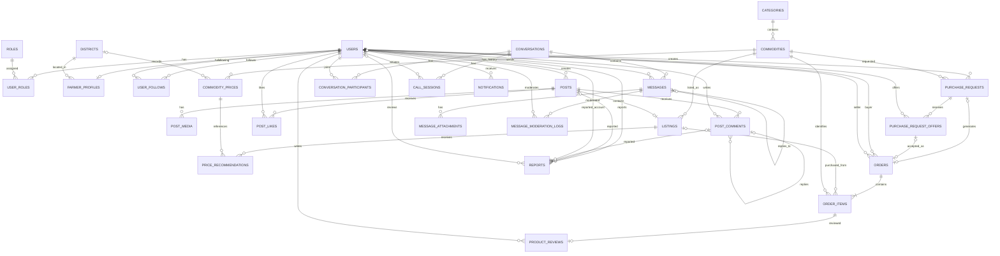

# TaniConnect - Database ERD

## 1. Overview

TaniConnect adalah platform pertanian yang menghubungkan petani dan pembeli melalui marketplace, komunitas, transaksi, komunikasi, serta sistem pelaporan.

Database menggunakan PostgreSQL dengan total **28 tabel**.

### Daftar Modul

| Modul | Jumlah Tabel |
|---|---:|
| Users & Roles | 6 |
| Community | 4 |
| Marketplace | 5 |
| Transactions | 5 |
| Chat & Communication | 6 |
| System & Reporting | 2 |
| **Total** | **28** |

---

## 2. Users & Roles

### 2.1 users

Menyimpan informasi akun seluruh pengguna.

| Kolom | Tipe Data | Constraint |
|---|---|---|
| id | BIGINT | PK |
| username | VARCHAR(50) | UNIQUE, NOT NULL |
| name | VARCHAR(100) | NOT NULL |
| email | VARCHAR(150) | UNIQUE, NOT NULL |
| password | VARCHAR(255) | NOT NULL |
| phone | VARCHAR(20) | UNIQUE |
| avatar | TEXT | NULL |
| status | VARCHAR(20) | DEFAULT 'ACTIVE' |
| created_at | TIMESTAMPTZ | NOT NULL |
| updated_at | TIMESTAMPTZ | NOT NULL |

### 2.2 roles

Menyimpan jenis role pengguna.

| Kolom | Tipe Data | Constraint |
|---|---|---|
| id | BIGINT | PK |
| name | VARCHAR(50) | UNIQUE, NOT NULL |
| description | TEXT | NULL |
| created_at | TIMESTAMPTZ | NOT NULL |

Role awal:
- ADMIN
- FARMER
- BUYER

### 2.3 user_roles

Menghubungkan pengguna dengan role. Satu pengguna dapat memiliki beberapa role.

| Kolom | Tipe Data | Constraint |
|---|---|---|
| user_id | BIGINT | PK, FK → users.id |
| role_id | BIGINT | PK, FK → roles.id |
| assigned_at | TIMESTAMPTZ | NOT NULL |

Primary Key menggunakan kombinasi `user_id` dan `role_id`.

### 2.4 districts

Menyimpan wilayah administratif.

| Kolom | Tipe Data | Constraint |
|---|---|---|
| id | BIGINT | PK |
| name | VARCHAR(100) | NOT NULL |
| city | VARCHAR(100) | NOT NULL |
| province | VARCHAR(100) | NOT NULL |
| created_at | TIMESTAMPTZ | NOT NULL |

### 2.5 farmer_profiles

Menyimpan informasi tambahan khusus petani.

| Kolom | Tipe Data | Constraint |
|---|---|---|
| id | BIGINT | PK |
| user_id | BIGINT | FK → users.id, UNIQUE |
| district_id | BIGINT | FK → districts.id |
| farm_name | VARCHAR(150) | NULL |
| address | TEXT | NULL |
| bio | TEXT | NULL |
| verification_status | VARCHAR(20) | DEFAULT 'PENDING' |
| created_at | TIMESTAMPTZ | NOT NULL |
| updated_at | TIMESTAMPTZ | NOT NULL |

### 2.6 user_follows

Menyimpan hubungan mengikuti antar pengguna.

| Kolom | Tipe Data | Constraint |
|---|---|---|
| follower_id | BIGINT | PK, FK → users.id |
| following_id | BIGINT | PK, FK → users.id |
| created_at | TIMESTAMPTZ | NOT NULL |

Primary Key menggunakan kombinasi `follower_id` dan `following_id`.

Aturan:
- Pengguna tidak dapat mengikuti dirinya sendiri.
- Satu pengguna tidak dapat mengikuti pengguna yang sama lebih dari satu kali.

---

## 3. Community

### 3.1 posts

Menyimpan postingan komunitas.

| Kolom | Tipe Data | Constraint |
|---|---|---|
| id | BIGINT | PK |
| user_id | BIGINT | FK → users.id |
| content | TEXT | NOT NULL |
| post_type | VARCHAR(20) | NOT NULL |
| created_at | TIMESTAMPTZ | NOT NULL |
| updated_at | TIMESTAMPTZ | NOT NULL |

Jenis postingan:
- THREAD
- LISTING

### 3.2 post_media

Menyimpan media yang dilampirkan pada postingan.

| Kolom | Tipe Data | Constraint |
|---|---|---|
| id | BIGINT | PK |
| post_id | BIGINT | FK → posts.id |
| media_url | TEXT | NOT NULL |
| media_type | VARCHAR(20) | NOT NULL |
| created_at | TIMESTAMPTZ | NOT NULL |

### 3.3 post_comments

Menyimpan komentar dan balasan komentar.

| Kolom | Tipe Data | Constraint |
|---|---|---|
| id | BIGINT | PK |
| post_id | BIGINT | FK → posts.id |
| user_id | BIGINT | FK → users.id |
| parent_id | BIGINT | FK → post_comments.id, NULL |
| content | TEXT | NOT NULL |
| created_at | TIMESTAMPTZ | NOT NULL |
| updated_at | TIMESTAMPTZ | NOT NULL |

`parent_id` digunakan untuk membuat komentar bertingkat atau balasan.

### 3.4 post_likes

Menyimpan pengguna yang menyukai postingan.

| Kolom | Tipe Data | Constraint |
|---|---|---|
| post_id | BIGINT | PK, FK → posts.id |
| user_id | BIGINT | PK, FK → users.id |
| created_at | TIMESTAMPTZ | NOT NULL |

Primary Key menggunakan kombinasi `post_id` dan `user_id`.

---

## 4. Marketplace

### 4.1 categories

Menyimpan kategori komoditas pertanian.

| Kolom | Tipe Data | Constraint |
|---|---|---|
| id | BIGINT | PK |
| name | VARCHAR(100) | UNIQUE, NOT NULL |
| description | TEXT | NULL |
| created_at | TIMESTAMPTZ | NOT NULL |

### 4.2 commodities

Menyimpan daftar komoditas yang tersedia.

| Kolom | Tipe Data | Constraint |
|---|---|---|
| id | BIGINT | PK |
| category_id | BIGINT | FK → categories.id |
| name | VARCHAR(100) | NOT NULL |
| unit | VARCHAR(30) | NOT NULL |
| description | TEXT | NULL |
| created_at | TIMESTAMPTZ | NOT NULL |

Constraint:
- UNIQUE(category_id, name)

### 4.3 listings

Menyimpan detail produk yang dijual petani.

| Kolom | Tipe Data | Constraint |
|---|---|---|
| id | BIGINT | PK |
| post_id | BIGINT | FK → posts.id, UNIQUE, NOT NULL |
| commodity_id | BIGINT | FK → commodities.id |
| price | NUMERIC(15,2) | NOT NULL |
| stock | NUMERIC(15,2) | NOT NULL |
| unit | VARCHAR(30) | NOT NULL |
| status | VARCHAR(20) | DEFAULT 'ACTIVE' |
| created_at | TIMESTAMPTZ | NOT NULL |
| updated_at | TIMESTAMPTZ | NOT NULL |

Status:
- ACTIVE
- INACTIVE
- SOLD_OUT

Constraint:
- price > 0
- stock >= 0

Setiap listing harus terhubung dengan satu postingan bertipe LISTING.

### 4.4 commodity_prices

Menyimpan riwayat harga komoditas berdasarkan wilayah.

| Kolom | Tipe Data | Constraint |
|---|---|---|
| id | BIGINT | PK |
| commodity_id | BIGINT | FK → commodities.id |
| district_id | BIGINT | FK → districts.id, NULL |
| price | NUMERIC(15,2) | NOT NULL |
| unit | VARCHAR(30) | NOT NULL |
| source | VARCHAR(100) | NULL |
| recorded_at | TIMESTAMPTZ | NOT NULL |

Tabel ini digunakan untuk menyimpan histori harga komoditas dan menjadi referensi harga pasar.

### 4.5 price_recommendations

Menyimpan rekomendasi harga untuk listing berdasarkan harga pasar.

| Kolom | Tipe Data | Constraint |
|---|---|---|
| id | BIGINT | PK |
| listing_id | BIGINT | FK → listings.id |
| commodity_price_id | BIGINT | FK → commodity_prices.id |
| reference_price | NUMERIC(15,2) | NOT NULL |
| minimum_price | NUMERIC(15,2) | NOT NULL |
| maximum_price | NUMERIC(15,2) | NOT NULL |
| recommendation_status | VARCHAR(20) | NOT NULL |
| created_at | TIMESTAMPTZ | NOT NULL |

Status rekomendasi:
- TOO_LOW
- FAIR
- TOO_HIGH

Constraint:
- minimum_price <= maximum_price

---

## 5. Transactions

### 5.1 purchase_requests

Menyimpan permintaan pembelian dari pembeli.

| Kolom | Tipe Data | Constraint |
|---|---|---|
| id | BIGINT | PK |
| buyer_id | BIGINT | FK → users.id |
| commodity_id | BIGINT | FK → commodities.id |
| quantity | NUMERIC(15,2) | NOT NULL |
| target_price | NUMERIC(15,2) | NULL |
| description | TEXT | NULL |
| status | VARCHAR(20) | DEFAULT 'OPEN' |
| created_at | TIMESTAMPTZ | NOT NULL |
| updated_at | TIMESTAMPTZ | NOT NULL |

Status:
- OPEN
- ACCEPTED
- CANCELLED
- COMPLETED

### 5.2 purchase_request_offers

Menyimpan penawaran dari petani terhadap permintaan pembelian.

| Kolom | Tipe Data | Constraint |
|---|---|---|
| id | BIGINT | PK |
| request_id | BIGINT | FK → purchase_requests.id |
| farmer_id | BIGINT | FK → users.id |
| offered_price | NUMERIC(15,2) | NOT NULL |
| message | TEXT | NULL |
| status | VARCHAR(20) | DEFAULT 'PENDING' |
| created_at | TIMESTAMPTZ | NOT NULL |
| updated_at | TIMESTAMPTZ | NOT NULL |

Status:
- PENDING
- ACCEPTED
- REJECTED
- WITHDRAWN

### 5.3 orders

Menyimpan transaksi pembelian dari listing maupun purchase request.

| Kolom | Tipe Data | Constraint |
|---|---|---|
| id | BIGINT | PK |
| order_source | VARCHAR(20) | NOT NULL |
| request_id | BIGINT | FK → purchase_requests.id, NULL |
| accepted_offer_id | BIGINT | FK → purchase_request_offers.id, UNIQUE, NULL |
| buyer_id | BIGINT | FK → users.id |
| seller_id | BIGINT | FK → users.id |
| status | VARCHAR(20) | DEFAULT 'PENDING' |
| total_amount | NUMERIC(15,2) | NOT NULL |
| created_at | TIMESTAMPTZ | NOT NULL |
| updated_at | TIMESTAMPTZ | NOT NULL |

Jenis sumber transaksi:
- LISTING
- REQUEST

Status:
- PENDING
- CONFIRMED
- PROCESSING
- SHIPPED
- COMPLETED
- CANCELLED

Aturan:
- Jika order_source = LISTING, request_id dan accepted_offer_id harus NULL.
- Jika order_source = REQUEST, request_id dan accepted_offer_id wajib terisi.
- Satu purchase request hanya dapat menghasilkan satu order.
- Satu accepted offer hanya dapat digunakan untuk satu order.
- buyer_id dan seller_id harus sesuai dengan pihak yang terlibat dalam transaksi.

### 5.4 order_items

Menyimpan detail komoditas dalam setiap transaksi.

| Kolom | Tipe Data | Constraint |
|---|---|---|
| id | BIGINT | PK |
| order_id | BIGINT | FK → orders.id |
| listing_id | BIGINT | FK → listings.id, NULL |
| commodity_id | BIGINT | FK → commodities.id |
| quantity | NUMERIC(15,2) | NOT NULL |
| unit | VARCHAR(30) | NOT NULL |
| price_snapshot | NUMERIC(15,2) | NOT NULL |
| subtotal | NUMERIC(15,2) | NOT NULL |

Aturan:
- Listing order wajib memiliki listing_id.
- Request order dapat memiliki listing_id NULL.
- commodity_id menyimpan komoditas yang dibeli.
- price_snapshot menyimpan harga saat transaksi dibuat.
- subtotal = quantity × price_snapshot.

### 5.5 product_reviews

Menyimpan ulasan pembeli terhadap produk yang telah diterima.

| Kolom | Tipe Data | Constraint |
|---|---|---|
| id | BIGINT | PK |
| order_item_id | BIGINT | FK → order_items.id, UNIQUE |
| reviewer_id | BIGINT | FK → users.id |
| rating | SMALLINT | NOT NULL |
| review | TEXT | NULL |
| created_at | TIMESTAMPTZ | NOT NULL |
| updated_at | TIMESTAMPTZ | NOT NULL |

Constraint:
- rating BETWEEN 1 AND 5
- Satu order item hanya dapat memiliki satu review.
- Review hanya dapat diberikan oleh pembeli setelah transaksi selesai.

---

## 6. Chat & Communication

### 6.1 conversations

Menyimpan ruang percakapan.

| Kolom | Tipe Data | Constraint |
|---|---|---|
| id | BIGINT | PK |
| type | VARCHAR(20) | NOT NULL |
| created_at | TIMESTAMPTZ | NOT NULL |
| updated_at | TIMESTAMPTZ | NOT NULL |

Jenis:
- DIRECT
- GROUP

### 6.2 conversation_participants

Menyimpan anggota percakapan.

| Kolom | Tipe Data | Constraint |
|---|---|---|
| conversation_id | BIGINT | PK, FK → conversations.id |
| user_id | BIGINT | PK, FK → users.id |
| joined_at | TIMESTAMPTZ | NOT NULL |
| last_read_at | TIMESTAMPTZ | NULL |
| is_muted | BOOLEAN | DEFAULT FALSE |
| is_archived | BOOLEAN | DEFAULT FALSE |

Primary Key menggunakan kombinasi conversation_id dan user_id.

### 6.3 messages

Menyimpan pesan dalam percakapan.

| Kolom | Tipe Data | Constraint |
|---|---|---|
| id | BIGINT | PK |
| conversation_id | BIGINT | FK → conversations.id |
| sender_id | BIGINT | FK → users.id |
| content | TEXT | NULL |
| message_type | VARCHAR(20) | DEFAULT 'TEXT' |
| reply_to_id | BIGINT | FK → messages.id, NULL |
| is_edited | BOOLEAN | DEFAULT FALSE |
| created_at | TIMESTAMPTZ | NOT NULL |
| updated_at | TIMESTAMPTZ | NOT NULL |

Jenis pesan:
- TEXT
- IMAGE
- FILE
- SYSTEM

### 6.4 message_attachments

Menyimpan lampiran pesan.

| Kolom | Tipe Data | Constraint |
|---|---|---|
| id | BIGINT | PK |
| message_id | BIGINT | FK → messages.id |
| file_url | TEXT | NOT NULL |
| file_name | VARCHAR(255) | NOT NULL |
| mime_type | VARCHAR(100) | NOT NULL |
| file_size | BIGINT | NOT NULL |
| created_at | TIMESTAMPTZ | NOT NULL |

### 6.5 message_moderation_logs

Menyimpan riwayat moderasi pesan.

| Kolom | Tipe Data | Constraint |
|---|---|---|
| id | BIGINT | PK |
| message_id | BIGINT | FK → messages.id |
| moderator_id | BIGINT | FK → users.id, NULL |
| action | VARCHAR(30) | NOT NULL |
| reason | TEXT | NULL |
| created_at | TIMESTAMPTZ | NOT NULL |

Jenis tindakan:
- FLAGGED
- HIDDEN
- RESTORED
- DELETED

### 6.6 call_sessions

Menyimpan riwayat panggilan dalam percakapan.

| Kolom | Tipe Data | Constraint |
|---|---|---|
| id | BIGINT | PK |
| conversation_id | BIGINT | FK → conversations.id |
| initiator_id | BIGINT | FK → users.id |
| call_type | VARCHAR(20) | NOT NULL |
| status | VARCHAR(20) | DEFAULT 'INITIATED' |
| started_at | TIMESTAMPTZ | NULL |
| ended_at | TIMESTAMPTZ | NULL |
| created_at | TIMESTAMPTZ | NOT NULL |

Jenis panggilan:
- AUDIO
- VIDEO

Status:
- INITIATED
- ONGOING
- COMPLETED
- MISSED
- REJECTED
- CANCELLED

---

## 7. System & Reporting

### 7.1 notifications

Menyimpan notifikasi untuk pengguna.

| Kolom | Tipe Data | Constraint |
|---|---|---|
| id | BIGINT | PK |
| user_id | BIGINT | FK → users.id |
| title | VARCHAR(150) | NOT NULL |
| message | TEXT | NOT NULL |
| type | VARCHAR(30) | NOT NULL |
| reference_id | BIGINT | NULL |
| reference_type | VARCHAR(30) | NULL |
| is_read | BOOLEAN | DEFAULT FALSE |
| created_at | TIMESTAMPTZ | NOT NULL |

`reference_id` dan `reference_type` digunakan untuk menghubungkan notifikasi dengan objek terkait, misalnya post, order, atau pesan. Validasi referensi dilakukan oleh aplikasi.

### 7.2 reports

Menyimpan laporan pengguna terhadap postingan, komentar, atau akun.

| Kolom | Tipe Data | Constraint |
|---|---|---|
| id | BIGINT | PK |
| reporter_id | BIGINT | FK → users.id |
| target_type | VARCHAR(20) | NOT NULL |
| post_id | BIGINT | FK → posts.id, NULL |
| comment_id | BIGINT | FK → post_comments.id, NULL |
| reported_user_id | BIGINT | FK → users.id, NULL |
| reason | VARCHAR(100) | NOT NULL |
| description | TEXT | NULL |
| status | VARCHAR(20) | DEFAULT 'PENDING' |
| reviewed_by | BIGINT | FK → users.id, NULL |
| reviewed_at | TIMESTAMPTZ | NULL |
| created_at | TIMESTAMPTZ | NOT NULL |
| updated_at | TIMESTAMPTZ | NOT NULL |

Target laporan:
- POST
- COMMENT
- ACCOUNT

Status:
- PENDING
- REVIEWED
- RESOLVED
- REJECTED

Aturan:
- POST harus memiliki post_id.
- COMMENT harus memiliki comment_id.
- ACCOUNT harus memiliki reported_user_id.
- Hanya satu target yang boleh diisi dalam satu laporan.
- reviewed_by menyimpan admin yang menangani laporan.
- reviewed_at menyimpan waktu penanganan laporan.

---

## 8. Database Constraints

### 8.1 Primary Keys

Sebagian besar tabel menggunakan kolom `id` sebagai primary key.

Tabel penghubung menggunakan composite primary key:

- user_roles: (user_id, role_id)
- user_follows: (follower_id, following_id)
- post_likes: (post_id, user_id)
- conversation_participants: (conversation_id, user_id)

### 8.2 Unique Constraints

- users.username
- users.email
- users.phone
- roles.name
- farmer_profiles.user_id
- listings.post_id
- product_reviews.order_item_id
- purchase_request_offers: tidak ada penawaran ganda yang dibatasi secara default
- orders.accepted_offer_id
- orders.request_id

### 8.3 Check Constraints

- user_follows.follower_id <> user_follows.following_id
- listings.price > 0
- listings.stock >= 0
- product_reviews.rating BETWEEN 1 AND 5
- posts.post_type IN ('THREAD', 'LISTING')
- price_recommendations.minimum_price <= price_recommendations.maximum_price
- orders.order_source IN ('LISTING', 'REQUEST')
- reports.target_type IN ('POST', 'COMMENT', 'ACCOUNT')
- reports.status IN ('PENDING', 'REVIEWED', 'RESOLVED', 'REJECTED')

Untuk `reports`, pastikan hanya satu dari post_id, comment_id, atau reported_user_id yang terisi dan sesuai dengan target_type.

### 8.4 Foreign Key Rules

- Data relasi yang bergantung pada data induk dapat menggunakan ON DELETE CASCADE.
- Data transaksi sebaiknya menggunakan ON DELETE RESTRICT agar riwayat transaksi tidak hilang.
- Relasi opsional seperti parent_id dan reviewed_by dapat menggunakan ON DELETE SET NULL jika sesuai kebutuhan.
- Penghapusan akun sebaiknya mengikuti kebijakan retensi data aplikasi.

### 8.5 Business Rules

1. Username dan email harus unik.
2. Pengguna dapat memiliki lebih dari satu role.
3. Setiap farmer profile dimiliki satu pengguna.
4. Post memiliki tipe THREAD atau LISTING.
5. Post bertipe LISTING wajib memiliki detail listing.
6. Harga listing harus lebih dari nol.
7. Stok listing tidak boleh negatif.
8. Pengguna tidak dapat mengikuti dirinya sendiri.
9. Pembeli dapat membuat purchase request.
10. Petani dapat memberikan penawaran pada purchase request.
11. Order dapat berasal dari listing atau purchase request.
12. Order dari purchase request harus memiliki request dan accepted offer.
13. Order item harus menyimpan snapshot harga transaksi.
14. Review hanya dapat diberikan oleh pembeli pada transaksi yang selesai.
15. Satu order item hanya dapat memiliki satu review.
16. Pengirim pesan harus menjadi peserta percakapan.
17. Pengguna hanya dapat mengubah atau menghapus pesan miliknya, sesuai kebijakan aplikasi.
18. Initiator panggilan harus menjadi peserta percakapan.
19. Laporan harus memiliki tepat satu target.
20. Hanya admin atau moderator berwenang yang dapat menangani laporan dan moderasi.

---

## 9. Entity Relationship Diagram

---

## 10. Notes & Implementation

1. Semua primary key menggunakan BIGINT.
2. Semua timestamp menggunakan TIMESTAMPTZ.
3. Password harus disimpan dalam bentuk hash, bukan plaintext.
4. Kolom status menggunakan VARCHAR dengan CHECK constraint agar nilainya konsisten.
5. Validasi relasi lintas tabel yang tidak dapat ditangani oleh CHECK constraint biasa dilakukan melalui service layer atau database trigger.
6. `notifications.reference_id` dan `notifications.reference_type` menggunakan relasi polymorphic sehingga validasi dilakukan oleh aplikasi.
7. `posts.post_type = 'LISTING'` harus memiliki pasangan data pada tabel listings. Aturan ini perlu dijaga melalui service layer atau trigger.
8. Untuk order REQUEST, backend harus memastikan accepted_offer_id berasal dari request_id yang sama dan seller_id sesuai dengan farmer_id penawaran.
9. Untuk order LISTING, backend harus memastikan seller_id adalah pemilik post dari listing terkait.
10. Untuk order item REQUEST, listing_id boleh NULL karena produk berasal dari penawaran, bukan listing marketplace.
11. Relasi peserta percakapan, pengirim pesan, dan initiator panggilan harus divalidasi oleh backend atau trigger.
12. Riwayat transaksi dan harga sebaiknya tidak dihapus secara permanen tanpa kebijakan retensi yang jelas.
